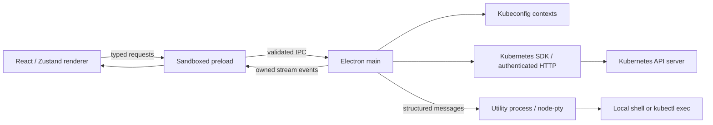

# Optic architecture

Status: expanded desktop workspace, October 23, 2026. Independent TypeScript implementation; no target source, assets, tokens, or closed-source branding are included.

## Evidence and design boundary

The inspected installed desktop application was version `2026.10.121159-latest`. Its ASAR SHA-256 was `ed2fa48861a43193e1132375fc09baddf415bb51db369406ae26454548be4f56`.

REA whole-application analysis retained partial evidence `ev_82a087dee002f0b668607ccb1e64c1aec12a382c591eb723eb419424b5bcbbee`; the result budget was exhausted before all sources were analyzed. Five unpacked executables disagreed with archive integrity metadata. Supplemental inspection read shipped source maps without executing their contents. Initial runtime evidence covered the process tree and listening sockets. A subsequent read-only UI inspection observed the installed application's welcome screen, navigator, resource table, overview gauges, workspace tabs and terminal dock. This is not a complete reconstruction of the target's IPC protocol or a claim of behavioral equivalence.

| Observation from inspection | Independent implementation decision |
| --- | --- |
| Main/renderer separation, native authentication proxy, resource stores | Main owns SDK clients and credentials; direct SDK requests replace the native/local proxy topology |
| MobX and feature dependency injection | Zustand for renderer selection/tab state; small explicit TypeScript services in main |
| Dynamically registered request/message/computed channels | Fixed channel allowlist, runtime schemas, typed request/results and explicit stream ownership |
| Node-enabled window factory in inspected source | Sandboxed renderer, context isolation, no Node integration, narrow preload |
| LIST/WATCH stores and resource-version recovery | Snapshot + WATCH cache per subscription, coalesced updates, relist on reconnect |
| Multiple PTY transports | One utility-process helper per terminal, with tab-scoped input/output and flow control |
| Inspected log viewer polls | Chunked REST follow streams with cancellation and acknowledgement backpressure |
| Prometheus provider discovery and Service proxy queries | Documented observation; Prometheus UI/provider integration is outside this initial core |
| Privileged CommonJS extension feature loading | No extension evaluator; a future extension API needs a separate capability design |

Evidence source-map areas included cluster configuration/model discovery, cluster connection/accessibility, internal proxy setup, cached/watched Kubernetes resources, messaging adapters, pod logs, terminal sessions, main view, and installed extension lifecycle. Their implementation text is not retained in this repository.

## Processes and trust boundaries

Main modules:

- `clusters.ts`: immutable per-context KubeConfig instances, discovery and health.
- `resources.ts`: resource descriptors, authenticated, paginated REST LIST operations, WATCH lifecycle, YAML read/replace, delete and rollout restart.
- `streams.ts`: session ownership, limits, event delivery and disposal.
- `sessions.ts`: log HTTP transport, decoder/backpressure, PTY utility lifecycle.
- `ipc/index.ts`: fixed handlers, main-frame/origin verification, runtime validation and error conversion.
- `pty-worker.ts`: native PTY ownership. Renderer never chooses arbitrary executable paths or shell argument strings through IPC. Local terminal input remains intentionally unrestricted terminal input.

Preload exposes only `window.desktop.request(channel, input)` and `subscribe(listener)`. Both channel names and payloads are restricted; no Electron event object, raw ipcRenderer, filesystem API, credentials, or shell object crosses the bridge. Main rejects untrusted URLs/subframes. New windows, webviews and permission requests are denied. Production CSP blocks external scripts, frames and objects.

## Cluster management

Discovery loads `~/.kube/config` and paths from `KUBECONFIG` (platform delimiter). `WORKBENCH_KUBECONFIG`, when set, is an exclusive source list intended for isolated profiles/testing. Paths are deduplicated. A native file picker imports additional kubeconfig references, persisted in the Electron user-data directory without copying credentials. The SDK resolves relative certificate/key paths. Invalid files produce diagnostic warnings without returning their content.

Each cluster ID is a hash of absolute file path plus context name. Each context receives its own KubeConfig object; selecting one never rewrites the global current context. Renderer receives only ID, context name, API server address, source filename and default namespace. Refresh reloads configs; this version does not continuously watch kubeconfig files.

Health requests Kubernetes `/version` on selection and at 30-second intervals. Authentication, TLS and exec credential plugins are handled by the SDK. Kubeconfigs are trusted local inputs: an exec credential plugin can execute a local program. The application does not disable TLS verification independently of the supplied kubeconfig.

API access is direct from main; no universal HTTP cache or local network proxy is introduced. External `kubectl` is required only for pod terminals. Local terminals do not require a cluster.

## Resource synchronization

The shared resource catalog covers workloads (Pods, Deployments, DaemonSets, StatefulSets, ReplicaSets, ReplicationControllers, Jobs, CronJobs), configuration (ConfigMaps, metadata-only Secrets, HPAs, PDBs, quotas, limits), networking (Services, Endpoints, Ingresses, NetworkPolicies), storage (PVCs, PVs, StorageClasses), access control (ServiceAccounts, Roles, RoleBindings, ClusterRoles, ClusterRoleBindings), Nodes, Namespaces, Events and CRDs. CRD details expose served versions; selecting one opens scoped custom-resource instances using the same watch/table/YAML pipeline.

Subscription procedure:

1. Register a unique stream ID with its owning renderer before starting asynchronous work.
2. LIST the selected scope and keep its resourceVersion.
3. Populate a UID-keyed cache and emit a snapshot.
4. WATCH from that version; apply ADDED/MODIFIED/DELETED and ignore bookmarks for presentation.
5. Coalesce presentation snapshots to at most one per 100 ms.
6. On disconnect or ERROR (including expired versions), retry with bounded exponential backoff/jitter and relist. Preserve the previous displayed snapshot until a successful relist.
7. On scope change, tab cleanup, navigation, renderer death or application quit, abort the stream and dispose timers/cache.

Caches are per subscription in this release; they are not yet shared across identical scopes. Paginated list requests are cancelled on disposal and have bounded HTTP timeouts. Disposal prevents late results from opening watches or updating the UI. Namespace RBAC failure is displayed independently of namespaced resource access. Users can reload configuration and retry after credentials change.

YAML replaces retain API version, kind, namespace, name and resourceVersion. A replacement cannot redirect to a different object. Status is excluded from replacement. Kubernetes optimistic concurrency rejects stale edits. Delete, restart and YAML save require an explicit UI confirmation. Rollout restart supports Deployments, StatefulSets and DaemonSets. Replica controllers expose confirmed scaling; Nodes expose confirmed cordon/uncordon. Manifest creation uses API discovery and server-side apply: the UI requires a successful dry run before enabling Apply, and edits invalidate validation. Secret values are removed from snapshots and unavailable for YAML viewing/editing.

## Complete application IPC protocol

This table describes **this project's** protocol, not the incomplete target inventory. `src/shared/protocol.ts` is the TypeScript contract; `src/main/validation.ts` is the runtime acceptance schema.

Common types:

- `Scope`: `{clusterId, kind, namespace?, custom?}`; kind is a catalog key or custom. Custom descriptors contain validated apiVersion, kind, plural and namespaced fields.
- `Target`: `Scope & {name}`. Namespaced mutation targets require a namespace.
- `PodTarget`: `{clusterId, namespace, pod, container?}`.
- Stream IDs: renderer-generated UUIDs, unique across live sessions, bound to sender WebContents. Maximum 24 live sessions per renderer.
- All requests return `{ok:true,data:T}` or `{ok:false,error:{code,message,retryable}}`. Void data may be undefined. Errors never echo raw SDK request objects, headers, tokens or response bodies.

| Request channel | Payload | Success data / effect |
| --- | --- | --- |
| `clusters:list` | undefined | `{clusters:Cluster[],warnings:string[]}`; reload configs |
| `clusters:connect` | {clusterId} | {version,latencyMs}; reload config and enable after health check |
| `clusters:disconnect` | {clusterId} | void; disable requests and close matching sessions |
| `settings:get` | {clusterId} | ClusterSettings including defaults |
| `settings:save` | {clusterId,settings:ClusterSettings} | ClusterSettings; validate, persist, close matching sessions |
| `settings:directory` | undefined | Native directory picker; path or undefined |
| `settings:reveal` | {clusterId} | void; reveal source kubeconfig |
| `cost:read` | {clusterId} | {source,currency,total,window,allocations,warning?} |
| `monitoring:version` | {component} | {version}; latest stable chart metadata from the fixed community repository, no cluster operation |
| `monitoring:status` | {clusterId} | {name,status,chart}[]; Optic-owned Helm releases |
| `monitoring:apply` | {clusterId,changes:{component,action,version}[]} | {completed:string[],error?}; ordered operations, partial failures explicit |
| `nodeshell:open` | {clusterId,node,id,cols,rows} | void; privileged helper pod then managed PTY |
| `clusters:remove` | {clusterId} | {clusters,warnings,backup}; backed-up context-only edit, closes matching sessions |
| `forward:start` | {id,clusterId,namespace,kind:pods/services,name,localPort,remotePort} | {localPort}; loopback kubectl listener; lifetime managed by stream:close |
| `clusters:import` | undefined | Native file picker; persisted source references; {clusters,warnings} |
| `metrics:read` | {clusterId} | {nodes,pods,warning?,source?}; selected metrics provider |
| `resources:apply` | {clusterId,namespace?,yaml,dryRun} | {name,kind,namespace?}; discovery + server-side apply |
| `resources:scale` | Target + {replicas} | void; scale subresource merge patch |
| `nodes:cordon` | {clusterId,name,unschedulable} | void; scheduling merge patch |
| `clusters:health` | `{clusterId}` | `{version,latencyMs}` |
| `resources:list` | Scope | Resource array |
| `resources:watch` | Scope + `{id}` | void; events deliver snapshots/errors |
| `resources:yaml` | Target | YAML string |
| `resources:replace` | Target + `{yaml}` | void; optimistic replacement |
| `resources:delete` | Target | void; Kubernetes delete |
| `resources:restart` | Target | void; workload rollout annotation |
| `logs:start` | PodTarget + `{id,tailLines?,previous?}` | void; chunk events, then end/error |
| `terminal:open` | `{id,clusterId?,namespace?,pod?,container?,cols,rows}` | void after PTY ready |
| `terminal:write` | `{id,data}` | void; maximum 65,536 characters per write |
| `terminal:resize` | `{id,cols,rows}` | void; columns 2–500, rows 1–200 |
| `stream:ack` | `{id,seq}` | void; acknowledge consumed data chunk |
| `stream:close` | `{id}` | void; close owned stream |

Only main emits `stream:event`:

| Discriminant | Event shape |
| --- | --- |
| `resources` | `{id,type:'resources',items:Resource[]}` |
| `data` | `{id,type:'data',data:string,seq:number}` |
| `error` | `{id,type:'error',error:Fault}` |
| `end` | `{id,type:'end',exitCode?:number}` |

Important error codes: `INVALID_INPUT`, `UNTRUSTED_SENDER`, `UNKNOWN_CLUSTER`, `UNKNOWN_STREAM`, `DUPLICATE_STREAM`, `STREAM_LIMIT`, `FORBIDDEN`, `NOT_FOUND`, `CONFLICT`, `REQUEST_FAILED`, `INVALID_RESOURCE`, `NAMESPACE_REQUIRED`, `REDACTED`, `UNSUPPORTED`, `NOT_TERMINAL`, `TERMINAL_TIMEOUT`, `TERMINAL_FAILED`, `NO_CONTAINER`, `SLOW_CONSUMER`.

Request replies use Electron invoke/handle correlation. Streaming uses explicit session IDs and monotonically increasing data sequence numbers. Watch errors are recoverable within the subscription; log/terminal errors normally end that stream. The UI tolerates cleanup racing an already closed stream.

## Logs and terminals

Logs use SDK authentication and TLS configuration with a chunked HTTP request to the container log subresource. Follow mode, timestamps, previous-container logs and initial tail limits are supported by the backend. The UI exposes current-container follow, filtering, auto-scroll and clearing. A streaming UTF-8 decoder preserves split multibyte characters. Writable callbacks await renderer acknowledgement, so a slow viewer applies backpressure. An unresponsive viewer is closed after 30 seconds. Visible log history is capped at one million characters; terminal scrollback is 5,000 lines.

Each terminal utility process owns one native PTY. Main selects a local user shell or constructs a `kubectl --kubeconfig ... --context ... --namespace ... exec -it ... -- /bin/sh` argv array. Arguments are not shell-concatenated. Pod shells currently target Linux containers with `/bin/sh`; custom/Windows container shells are a follow-up.

PTY data is sequenced; the helper pauses at 256 KiB unacknowledged output and resumes below 64 KiB. xterm acknowledges after its write callback. Input, resize, exit and close are routed by session ID. Closing a dock tab kills its PTY; there is no detached-session reconnection in this version. Application quit disposes all helpers.

## UI component hierarchy

The independent charcoal-and-blue shell follows the observed desktop layout without target assets or branding:

- App: native window controls, draggable titlebar, command palette (Ctrl+K), activity rail and status bar.
- Navigator: local kubeconfig contexts, filterable grouped resource tree, import and reload.
- Workspace: closable context/resource tabs, Welcome, Preferences and the eight-section ClusterSettingsPage.
- Overview: live metrics-server CPU/memory history (15-second samples), usage/request/limit gauges, resource counts and workload/event observations. Missing metrics are labeled unavailable.
- ResourceTable: namespace filtering, search, sorting, pagination, JSON export, row selection and confirmed batch delete.
- Details: metadata, labels, containers, events, YAML, custom-resource versions and confirmed mutations.
- ManifestDialog: editable YAML, server dry-run validation, then explicit apply.
- Dock: resizable terminal/log tabs, collapse without ending sessions, xterm fit/flow control, bounded logs with filtering/follow.

Zustand tracks workspace tabs and their cluster/namespace scope separately from dock sessions. Switching views disposes their resource subscriptions; terminal/log sessions remain mounted until closed. Imported kubeconfig references persist; workspace tabs are currently session-local.

## Validation and remaining scope

Unit tests cover payload boundaries, resource identity/concurrency constraints, stream ownership/limits, error redaction and crash-state display. The Electron smoke test uses an isolated kubeconfig and local fake Kubernetes API; it checks secure window preferences, resource discovery/watch, detail YAML, confirmed writes, log delivery and a real native PTY.

Live cluster compatibility, external credential-provider combinations, large-cluster load, Windows-container shells and macOS/Linux packaging require environment-specific validation. Prometheus historical dashboards, extension hosting, a general-purpose Helm release manager and detached reconnectable terminals are follow-up scope. No target-native binary is shipped.

Tooling follows the official [electron-vite configuration model](https://electron-vite.org/guide/) and the installed [Kubernetes JavaScript client](https://github.com/kubernetes-client/javascript) public interfaces. Dependency versions are locked in package-lock.json.

Current validation: 27 unit tests and the expanded source-build Electron integration suite pass. The Windows unpacked build succeeds. Windows Device Guard blocked the rebuilt executable before Playwright could connect; packaged runtime verification is therefore pending an organization-approved signing/deployment path. No security policy was changed.

Cluster context menus expose connection checks, settings, local appearance/hotbar preferences and backed-up context removal. Port forwards use shell-free kubectl argv, a 20-second readiness deadline, bounded diagnostic parsing, loopback binding, renderer ownership and context-scoped disposal. Renderer crash recovery and explicit log reconnection are implemented. Windows CI is configured; live-cluster acceptance and signed distribution remain release gates.

## Cluster settings implementation

`src/shared/cluster-settings.ts` defines the settings contract and defaults; the matching Zod schema validates every save. Main persists settings atomically in `cluster-settings.json`, keyed by cluster ID. Settings include appearance, proxy, terminal defaults, manually accessible namespaces, metrics source/visibility/Service endpoint, cost source/endpoint/rate and node-shell image/pull secret. General does not expose credential values or rewrite authentication configuration.

ClusterManager applies proxy overrides to the selected SDK KubeConfig. CLI sessions receive an ephemeral configuration containing only the selected context, cluster and user, with absolute certificate references and the saved default namespace. The temporary file is removed on session disposal; original configs remain unchanged. Disconnect state is session-local and blocks new operations until Connect succeeds. Saving settings closes affected sessions; monitoring operations lock settings changes, disconnect and removal while running.

Providers use authenticated Kubernetes Service-proxy requests to existing Prometheus and OpenCost/Kubecost endpoints. Automatic metrics prefers metrics-server and falls back to Prometheus. Prometheus currently normalizes aggregate/node instant CPU/memory samples, with no historical range-query implementation. Only existing metrics views consume visibility preferences. Cost estimates explicitly use a uniform user-specified USD/node-hour rate, not cloud SKU pricing.

Monitoring runs shell-free Helm commands with explicit chart versions, bounded execution and managed release names. The renderer reviews mutations before invoking apply. Partial completion is returned separately from errors. Only monitoring components are supported; there is no generic Helm manager. Node shells create a privileged helper pod, wait for readiness, then use the existing managed PTY to exec host `nsenter`. Closure deletes the pod using its UID; the active deadline limits execution after unexpected process loss. Crash recovery does not automatically collect stopped helper pods.

Additional error codes include DISCONNECTED and INVALID_DIRECTORY; operational failures use the common sanitized error envelope. Cluster settings, provider response normalization, generated configurations, helper lifecycle and Helm argv are unit-tested. The isolated Electron suite verifies all settings sections, persistence, manual namespaces, disabled metrics, estimates and disconnect/reconnect. Live Helm, proxy and privileged-node compatibility remain acceptance work. See README for dependencies and operational limits.

Chart version lookup uses bounded HTTPS requests to the fixed community repository index, caches it for five minutes, selects the highest non-deprecated stable chart version and autofills Install/upgrade without executing Helm. The reviewed version is passed unchanged to install; failures permit retry or manual entry. See the [Helm show chart reference](https://helm.sh/docs/helm/helm_show_chart/).
